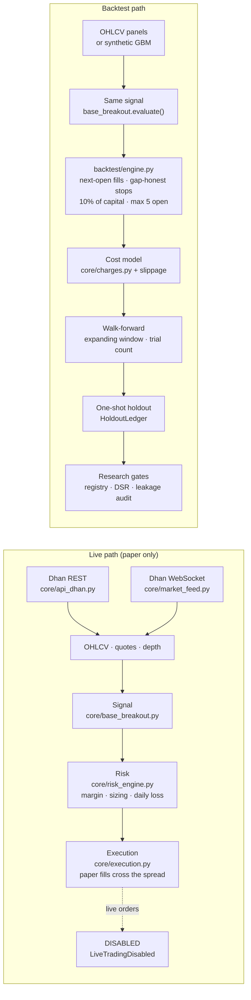

# NSE F&O Research Stack

A research and paper-trading stack for Indian equities and F&O: a broker data
feed (Dhan REST + WebSocket), a rule-based signal detector, a margin- and
cost-aware risk layer, a paper execution layer, and a walk-forward backtester
with an itemised Indian cost model and coded research guardrails.

> **Status.** Research and education only. **Live order placement is not
> included** (see [Safety](#safety)), and the backtests run on this code
> **did not show a reliable edge** (see [Results](#results)). Nothing here is
> investment advice.

The whole test suite, including an end-to-end backtest, runs on synthetic data
with no broker account:

```bash
pip install -r requirements.txt
pytest -q
```

---

## What it does

| Stage | Module | What it does |
|---|---|---|
| **Data feed** | `core/api_dhan.py` | Dhan v2 REST client: daily and intraday OHLCV, quotes with L2 depth, option chains and expiries, rate limiting, token health. Credentials come from the environment only. |
| | `core/market_feed.py` | Live WebSocket feed: wraps the dhanhq `DhanFeed` in a daemon thread with its own asyncio event loop. Gives thread-safe reads of last price, volume and order-book pressure. |
| | `core/scrip_master.py`, `core/nse_calendar.py` | Symbol → security-id mapping and lot sizes from the broker's scrip master; NSE holidays and holiday-shifted monthly/weekly expiries. |
| **Signal** | `core/base_breakout.py` | Base-breakout detector over wide panels (dates × symbols): trend template, 8-week base, short-term pivot, volume-confirmed close through it. Point-in-time throughout. |
| | `core/corporate_actions.py` | Flags split and bonus days so they cannot read as −50% moves or fake breakouts. |
| **Risk** | `core/risk_engine.py` | Position limits, daily-loss stop computed as a ratio of capital, drawdown, and a fail-closed margin-affordability check. |
| | `core/margin.py`, `core/sizing.py`, `core/selection.py` | SPAN + exposure margin estimator, one ordered sizing pipeline (liquidity → fundability → live lot size), turnover-tiered universe. |
| **Execution** | `core/execution.py` | **Paper only.** A fill crosses the spread plus slippage off a live quote. With no quote it falls back to the requested price and labels the source; with no price at all it refuses the fill rather than inventing one. Exits: stop, target, time and scratch, volume dry-up, trailing. |
| **Costs** | `core/charges.py`, `core/smallcap_costs.py` | Itemised contract-note charges per segment, plus a turnover-tiered impact model for less liquid names. |
| **Backtest** | `backtest/engine.py`, `backtest/synthetic.py` | Portfolio backtester: next-open fills, gap-honest stops, capital-based sizing, walk-forward with trial counting, one-shot holdout. GBM data generator. |
| **Guardrails** | `core/hypothesis_registry.py`, `core/research_gates.py`, `core/deflated_sharpe.py`, `core/leakage_audit.py`, `core/event_stat_gate.py` | Pre-registration and trial count, a seven-gate checklist, Deflated Sharpe and Benjamini–Hochberg, coded leakage checks, and a clustered-bootstrap event gate with Bonferroni correction. |

## Architecture



The live path and the backtest call the **same** `evaluate()`. A backtest and
a live scan therefore cannot quietly disagree about what a signal is.

## Quick start

```bash
pip install -r requirements.txt
pytest -q                           # 75 tests, no broker account, no network
```

A backtest on synthetic data:

```python
from backtest.synthetic import gbm_panels
from backtest.engine import run, BacktestConfig, CostModel

panels = gbm_panels(n_symbols=60, n_days=750, seed=0)    # no edge by construction
res = run(panels, BacktestConfig(capital=1_000_000), CostModel(slippage_bps=5))
print(res.summary)        # trades, return vs equal-weight buy-and-hold, charges, drawdown
print(res.trades.head())  # one row per round trip: fills, exit reason, gross, charges, net
```

To use the live data feed, copy `.env.example` to `.env` and fill in your own
broker credentials. `.env` is git-ignored, and the code only ever reads it.

## The cost model

Every round trip is charged the itemised schedule an Indian discount broker
prints on a contract note (`core/charges.py`). This is the default schedule.
Rates are revised by SEBI and the exchanges, and brokerage varies by broker,
so override any segment through `config.CHARGE_RATES` and check against a real
contract note before trusting absolute figures.

| Charge | Futures | Options | Delivery (equity) | Intraday (equity) |
|---|---|---|---|---|
| **Brokerage** | ₹20 or 0.03% per order, whichever is lower | ₹20 flat per order | free (discount-broker norm) | ₹20 or 0.03% per order, whichever is lower |
| **STT** | 0.02% on the **sell** leg | 0.1% of **premium** on the sell leg | 0.1% on **both** legs | 0.025% on the sell leg |
| **Exchange transaction fee** | ~0.00173% per side | 0.03503% of premium per side | 0.00297% per side | 0.00297% per side |
| **SEBI turnover fee** | ₹10 per crore | ₹10 per crore | ₹10 per crore | ₹10 per crore |
| **Stamp duty** | 0.002% on the **buy** leg | 0.003% of premium on the buy leg | 0.015% on the buy leg | 0.003% on the buy leg |
| **GST** | 18% of brokerage + exchange fee + SEBI fee | same | same | same |

Rules that are easy to get wrong, and are encoded and tested:

- STT is **sell-side only** for futures and options, but **both legs** for delivery.
- Stamp duty is **buy-side only**.
- Options STT, exchange fee and stamp duty are charged on **premium turnover**, not on notional.
- GST applies to brokerage, the exchange fee and the SEBI fee, **not** to STT or stamp duty.
- Each line item is rounded **before** totalling, so the itemisation adds up to the paisa, as a contract note does.

**Slippage** is modelled separately from statutory charges, because it is a
market-microstructure cost, not a fee:

- The backtester fills at the next open, moved against you by `CostModel.slippage_bps` on **both** fills (default 5 bps each).
- Paper execution fills off a live quote and crosses the spread plus slippage (`PAPER_FILL_COST_BPS`: equity 5, futures 5, options 50 bps). `USE_MOCK_DATA=1` is the only mode that uses a nominal price, and it is labelled `MOCK`.
- For less liquid names, `core/smallcap_costs.py` applies a turnover-tiered all-in impact estimate: about 0.2% round trip at ₹1,000 Cr+/day, rising to about 4% below ₹30 Cr/day. On a thin small-cap, spread and impact rather than statutory fees decide whether a result survives.

## Research guardrails

Most backtests that look like an edge are leakage, multiple testing or cost
blindness. These checks are code, not a checklist:

**Pre-registration and trial counting** (`core/hypothesis_registry.py`).
A study must be registered with its thesis and test plan **before** it runs.
The append-only ledger's trial count feeds the multiple-testing correction,
and a closed hypothesis is never un-counted.

**One-shot holdout** (`backtest/engine.py` `HoldoutLedger`). The final segment
of the sample is evaluated exactly once. A second look is refused, with the
same configuration or a different one, because a holdout you can retry is just
more training data.

**Walk-forward with trial count** (`backtest/engine.py` `walk_forward`). An
expanding window: each configuration is scored on earlier folds, and only the
chosen one runs on the next, unseen fold. The result always reports how many
configurations were tried, because a best-of-N result means nothing without N.

**Multiple-testing correction.**
- `core/deflated_sharpe.py` implements Bailey & López de Prado's Deflated Sharpe Ratio. It adjusts for the number of trials, the variance of their Sharpe ratios, and non-normal returns. It also provides minimum track-record length and Benjamini–Hochberg FDR control.
- `core/event_stat_gate.py` applies Bonferroni correction across every event type and horizon tested, with a **clustered bootstrap** that resamples symbols rather than events. Many events share a stock, and naive t-tests overstate significance.

**Leakage audit** (`core/leakage_audit.py`). Mechanical PASS / WARN / FAIL
checks on study inputs:
1. duplicate events
2. events dated past the last price bar
3. entry timing (entry must be on or after the event, never before)
4. survivorship
5. baseline contamination
6. holdout-ledger integrity

**The gate checklist** (`core/research_gates.py`). A result is only promoted to the holdout if it passes all seven gates:
1. **Baseline:** it beats simply holding the same universe for the same horizon.
2. **Spread t-stat:** its t-statistic is computed on the spread over that baseline, not on raw returns.
3. **Point in time:** the universe is the one actually listed that day, not survivors.
4. **Corporate actions:** split and bonus days are neutralised.
5. **Cost sweep:** the sign does not flip anywhere in the plausible cost range.
6. **Shuffle:** it beats a matched shuffled null.
7. **Fundability:** the account could actually carry the book that was tested.

An unrun gate counts as a fail, never a pass.

**No lookahead, tested.** The backtest suite rescales every price after a
cutoff and asserts that trades closed before the cutoff are unchanged. It also
asserts that a signal never trades on the bar that produced it.

**A random walk must stay a random walk.** `tests/test_backtest_gbm.py` runs
the full engine on geometric Brownian motion, which has no edge by
construction, across five seeds. It asserts that the engine reports no
significant excess over buy-and-hold. An engine that "finds" an edge in GBM is
leaking the future or mis-charging costs.

## Results

**The backtests did not show a reliable edge on the available sample.**
Hypotheses tested with this stack were rejected by the guardrails above. They
did not beat simply holding the same stocks once costs were charged, or their
result depended on a single year or on untradeable illiquid names. This
repository is published for its engineering: the data plumbing, the cost
model, the backtester and the research discipline. It is not a strategy, and
it does not report a track record.

## Safety

- **Live order placement is not included.** `core/api_dhan.py` keeps `place_order`, `modify_order` and `cancel_order` only so call sites read naturally. Each one raises `LiveTradingDisabled`, and the request-building code is not in the repository.
- `LIVE_TRADING_ENABLED = False` is a **constant**. It is not read from the environment or from `config.py`, and the order methods would not send anything even if it were changed.
- `core/execution.py` is always in paper mode.
- `tests/test_live_trading_disabled.py` pins all of this. It includes a static check that no method sends `PUT`/`DELETE`, or `POST`s to `/orders`.
- Credentials are read from the environment or a git-ignored `.env` (`core/secrets.py`) and are never written anywhere by the code.

## Repository layout

```
core/            data feed, signal, risk, execution, costs, guardrails
backtest/        engine.py (walk-forward, holdout) · synthetic.py (GBM)
tests/           75 tests, all offline
config.py        parameters only - no credentials
.env.example     the variables the live data feed reads
```

## Limitations

- Statutory rates, margin requirements and exchange lot sizes change. The code prefers live values (the scrip master for lot sizes) and treats static tables as fallbacks.
- The margin model is an estimator (SPAN + exposure + a buffer), not the exchange's number.
- No market data is included. The event-study guardrails (`leakage_audit`, `event_stat_gate`) run against your own event and price files.
- The base-breakout detector works on daily bars only.
